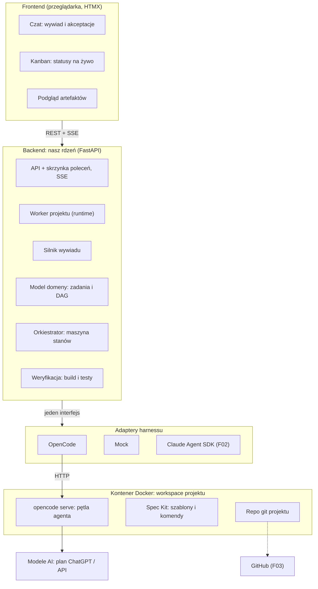
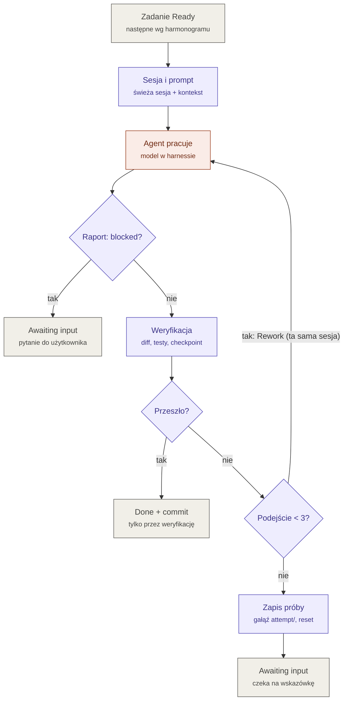
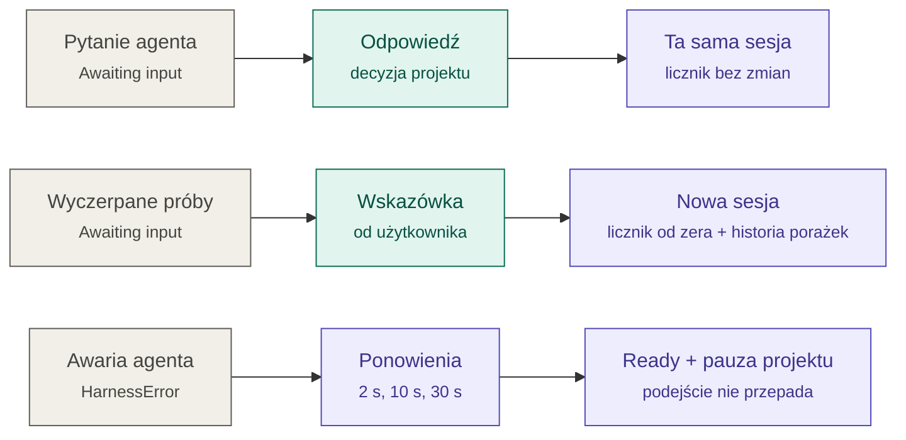

# Architektura

## Warstwy



## Przepływ pracy

```
[1] Agent wywiadu ──► bramka: użytkownik akceptuje specyfikację
[2] Agent planisty (/speckit.plan, /speckit.tasks, /speckit.analyze) ──► bramka: akceptacja planu
[3] Builder DAG (kod) ──► kanban: Backlog / Ready
[4] Orkiestrator (kod) ──► wybiera następne zadanie Ready
[5] Harness (OpenCode w Dockerze) ──► agent wykonawczy realizuje zadanie
[6] Weryfikacja: build/testy (kod) → recenzent (LLM, F01)
      OK    → Done + commit
      błąd  → Rework (maks. 2 próby) → [5]
      pytanie / decyzja → Awaiting input → użytkownik → [5] albo [1]/[2]
[7] Po wszystkich zadaniach: weryfikacja całości → demo → akceptacja użytkownika
[8] Zmiana wymagań → [1], przeplanowanie tylko części dotkniętych zmianą
```

## Orkiestrator: pętla jednego zadania

Kod (deterministyczny) decyduje o każdym kroku; model pracuje tylko w kroku „Agent pracuje”.
Szczegóły: `src/specflow/orchestrator/engine.py`, ADR-0001, ADR-0006.



## Orkiestrator: powroty z Awaiting input i awarie

Wszystkie ścieżki kończą się powrotem zadania do Ready, ale z innym kontekstem.



## Praca w tle i postęp na żywo (ADR-0008)

```
przeglądarka ──POST──► API ──► tabela commands (inbox)
                                   │
                         worker projektu (jedyny, kto zmienia stan)
                           ├─ polecenia czatu → ProjectFlow (wywiad, planista)
                           └─ budowa → Orkiestrator (jedno zadanie na krok)
                                   │ każdy krok i każde zdarzenie agenta
                                   ▼
                             tabela events ──► szyna w pamięci ──► SSE ──► przeglądarka
                                                (powiadomienie)     (czyta z bazy po Last-Event-ID)
```

W przeglądarce (ADR-0009) klient SSE nie składa widoków sam: po zdarzeniu prosi serwer
o świeży fragment HTML (czat, tablica, karta zadania), a narrację dopisuje jako tekst.

Przy starcie Specflow uzgadnia stan (przerwane zadania wracają do Ready, przerwane polecenia
są wznawiane). Narrację dla użytkownika składa kod (`web/narration.py`), nie model.

## Co jest AI, a co kodem

| Element | Kto | Wynik |
|---|---|---|
| Agent wywiadu | LLM (w F00 przez OpenCode, bez narzędzi) | Odpowiedzi → `/speckit.constitution`, `/speckit.specify`, `/speckit.clarify` |
| Agent planisty | LLM w harnessie | `plan.md`, `data-model.md`, `tasks.md` |
| Builder DAG | **kod** | Graf zadań w bazie, po walidacji |
| Orkiestrator | **kod** | Kolejność, limity, statusy |
| Worker, odzyskiwanie po awarii, narracja postępu | **kod** | Polecenia po kolei, wznowienia, opis zdarzeń dla użytkownika |
| Agent wykonawczy | LLM w harnessie | Kod dla jednego zadania |
| Testy | LLM, w **osobnym zadaniu przed implementacją**, na podstawie kryteriów akceptacji | Pliki testów |
| Weryfikacja | **kod** (build, typy, lint, testy), potem LLM-recenzent (F01) | OK / Rework / Awaiting input |
| Kryteria akceptacji i odbiór | **użytkownik** | Zatwierdzona specyfikacja, akceptacja demo |

Zasada: model **proponuje**, kod **sprawdza i decyduje**. Status `Done` ustawia orkiestrator
na podstawie wyniku weryfikacji, nigdy na podstawie deklaracji agenta.

## Źródło prawdy

Artefakty Spec Kit (`spec.md`, `plan.md`, `tasks.md`) są w repo projektu, ale po imporcie
źródłem prawdy dla zadań i statusów jest baza Specflow. Markdown jest wejściem i projekcją,
nie stanem.
